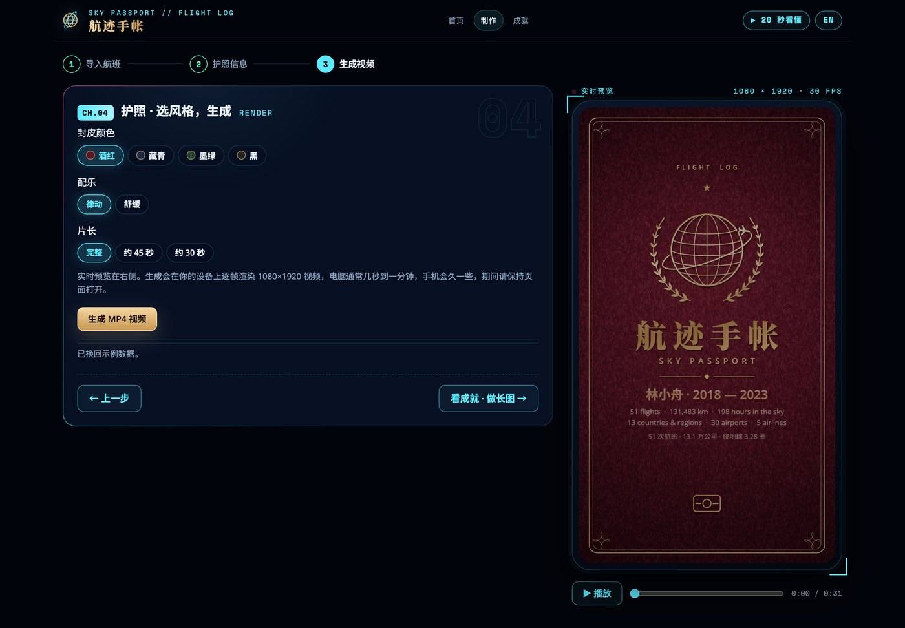

<div align="center">

# 航迹手帐 · Sky Passport

**把航班记录变成一本会动的护照：约一分钟竖屏影片，原创配乐，全程在你的浏览器里完成。**

[](https://passport.nybbq.art/) [](https://sky-passport.vercel.app/) [](#隐私) [](#影片) [](https://developer.mozilla.org/docs/Web/JavaScript)

**简体中文** · [English](README.en.md)

<a href="https://passport.nybbq.art/"></a>

<sub>首页 · 示例旅客（虚构）的航迹地球与统计 · 数据只来自本地示例文件</sub>

</div>

---

## 简介

航迹手帐把一份航班记录变成一支 1080×1920、30 fps 的竖屏短片：护照封皮打开，地图逐行打印，登机牌翻页，航线依次亮起，印章落下，最后合上护照，生成一张可打印的长图海报。

它不做幻灯片式回顾。每一帧都由同一个确定性渲染函数生成，配乐由 Web Audio 实时合成，视频由 WebCodecs 在你的设备上编码。默认情况下表格不离开浏览器：没有账号、没有上传、没有后端。

站点提供中英文界面，桌面与手机共用同一套代码。微信小程序是同一套解析与渲染引擎的原生封装，视频由服务器渲染。

## 功能

### 导入航班

| 能力 | 说明 |
|---|---|
| **表格导入** | 航旅纵横 `.xls/.xlsx`、Flighty、myFlightradar24、OpenFlights 导出的 CSV，或按模板填写的通用表格 |
| **机场解析** | 三字码、中文名（约 738 个关键词）、英文城市名；按最长匹配消歧，解析不了可手动指定 IATA |
| **手动输入** | 日期 + 起降机场 + 可选航班号，适合补录或没有导出文件的用户 |
| **截图识别** | 上传行程截图，服务端 OCR 按位置还原航班；识别完即丢弃（国内站） |
| **表格检查** | 未知机场、缺日期、重复行、状态文本、火车/车站行逐条列出，可就地修正并导出干净的 CSV |
| **AI 复核（可选）** | 只把需要判断的单元格发给服务端；置信度 ≥0.85 一键采纳，0.5–0.85 需确认 |

### 影片

- **1080×1920 · 30 fps**，完整片长约一分钟；片长选项只压缩年份段落，开场与结尾的节奏不变。
- 四种封皮（酒红 / 藏青 / 墨绿 / 黑）、两种配乐（律动 / 舒缓）。
- 开场：封皮烫金徽章 → 翻盖 → 地图逐行打印 → MRZ 打字机；结尾：急停 → 悬停 → 印章砸下 → 航线脉冲 → 合上护照 → 海报。
- 年份是里程表式翻页，航班号用翻牌板滚动，只显示航班号与 IATA 航线。
- **原创配乐**：112 BPM、每小节一个和弦（Fmaj7–Em7–Dm7–Cmaj7），三音动机在每年重拍上换音色；音效使用真实 CC0 录音，母带 −14 LUFS / ≤ −1 dBTP。
- **导出**：WebCodecs 编码 H.264 8 Mbps + AAC 192 kbps 的 MP4；不支持时自动退回 VP9/Opus 或实时 MediaRecorder。
- 另可导出视频封面图与结尾二维码海报。

<a href="https://passport.nybbq.art/#/studio/s3"></a>

<sub>制作页 · 选封皮、配乐与片长，右侧是 1080×1920 实时预览</sub>

### 成就与分享

- **33 枚勋章**，按距离、地点、时间、空中四组，分基础 / 银 / 金 / 传奇四档；未解锁的会写明条件与进度。
- 挑选勋章印进 **1080 宽长图海报**（「夜航」与「经典护照」两种版式）。
- 分享卡：小红书 3 张（封面 / 航线 / 勋章）与单枚勋章卡；小程序另有 5:4 分享卡。

### 微信小程序

原生实现（个人主体不能用 web-view）：首页成片轮播 → 选表 / 截图 / 手动输入 → 手机端解析 → 统计、成就、长图海报。视频由服务器用同一引擎渲染，约 3 路并行，可在小程序内播放并存入相册，**24 小时后删除**。

## 它是怎么工作的

```text
表格 / 截图 / 手动输入
        │
        ▼  core.js     解析 · 机场消歧 · 时区时长 · 去重 · 诊断
        ▼  engine.js   场景编排 · 镜头 · 地图 · 逐帧绘制
        ▼  music.js    112 BPM 原创配乐 + CC0 音效
        ▼  export.js   WebCodecs H.264/AAC → MP4
```

- **确定性渲染**：所有随机都来自种子 PRNG，`renderFrame(i)` 是帧号的纯函数——同一输入、同一帧号，永远得到同一画面。
- **Canvas 2D**：国界、经纬网、国家轮廓按投影缓存成 `Path2D`；预览与导出走同一条绘制路径。
- **声音**：配乐在运行时构建的 Web Worker 里合成，和画面共用同一张 BPM 网格；`ensureAudio()` 返回 Promise，导出前等待就绪。
- **字体与国旗**：用到的每个 CJK 字形在预览/导出前预加载，视频中途不会换字体；国旗 SVG 只栅格化一次。
- **失败回退**：WebCodecs 不可用或音轨校验失败时，退回实时录制，用户仍能拿到文件。

### 服务端渲染（小程序）

`web/server/render.js` 用共享的无头 Chromium 分 3 个页面并行渲染帧段，各自喂给 x264，最后无损拼接；只有第一个页面合成音轨。产物上传腾讯云 COS，本地文件随即删除，nginx 用 302 保持同一个下载地址。

### 中国地图

中国轮廓来自 `china.json`（DataV.GeoAtlas / 高德标准轮廓，含台湾、藏南、阿克赛钦、南海诸岛），九段线始终绘制，其他国家填色被裁出中国轮廓，台湾显示中性的「台湾」标注而不是国旗；港澳台英文名统一为 "…, China"。

> 正式出版中国地图仍需审图号。以上做法降低风险，但不替代审批。

## 隐私

- **默认本地**：表格、姓名、照片只在浏览器内存与 localStorage 中，刷新即走。
- **AI 复核**（可选）：只发送需要判断的单元格与候选机场，页面会写清发送内容；不发送整张表。
- **截图识别**：图片上传到国内服务器交给腾讯云 OCR，识别完立即丢弃，不落盘。
- **使用统计**：只记录事件名与按日加盐的匿名访客哈希，不含航班、姓名或任何行程信息。
- **小程序**：视频在服务器渲染，任务完成后 24 小时删除；源文件不长期保存。

## 快速开始

要求：Node.js 18+。浏览器需要支持 Canvas 2D；导出视频建议使用支持 WebCodecs 的 Chrome / Edge。

```bash
cd web
npm install
npm run build:data     # 生成 airports.json、world-50m.json、国旗等
npm run dev            # http://localhost:5173
```

没有打包步骤：`index.html` 直接加载 `public/js/` 下的 classic scripts。WebCodecs 需要 HTTPS 或 localhost。

AI 复核依赖 Vercel 环境变量 `TYPESAFE_API_KEY`，本地用 `vercel dev` 才会启用；`npm run dev` 只起静态页，AI 按钮会提示服务不可用。

### 常用命令

```bash
cd web
npm test               # node:test + vm，无第三方依赖
npm run build:china    # 重新生成 china.json
npm run build:fonts    # 自托管字体（大陆访问不到 Google Fonts）
npm run stamp          # 把内容哈希写进 index.html，部署前必跑
```

## 项目结构

```text
.
├── web/
│   ├── public/            单页应用：index.html + js/ + 数据 + 字体 + 音效
│   ├── api/check.js       AI 复核（Vercel Serverless）
│   ├── server/            国内 API：截图 OCR、视频渲染、COS 同步、统计
│   ├── scripts/           构建数据 / 中国地图 / 字体 / 版本戳 / 小程序代码
│   ├── deploy/            nginx、systemd、watchdog、部署脚本
│   ├── tests/             单元测试 + Playwright 冒烟测试
│   └── promo/             宣传片与品牌片的渲染脚本
├── miniprogram/           微信小程序（原生，libs 由 web/scripts 生成）
├── video-pipeline/        个人版离线渲染管线（Python + 无头 Chrome + ffmpeg）
├── docs/                  审计报告、进度与截图
└── .github/workflows/     CI：单元测试 + 浏览器端到端
```

## 测试

```bash
cd web && npm test
```

- `tests/core.test.js`：解析、机场消歧、时长、去重、诊断。
- `tests/shots.test.js`：截图 OCR 文本 → 航班的版面还原。
- `tests/e2e/smoke.py`：Playwright 跑桌面与手机两种视口——导入、手动输入、三个视图、33 枚勋章、两种海报，以及一次**带声音的真实 MP4 导出**。

CI 在每次 push 与 PR 上先跑单元测试，再构建数据与字体后跑浏览器测试。

## 部署

| 环境 | 方式 |
|---|---|
| **海外** | Vercel 静态部署 `web/public`，英文界面，AI 复核开启 |
| **国内** | 腾讯云 Lighthouse + nginx，静态资源走 COS/CDN，systemd 跑渲染服务，watchdog 每两分钟检查 |
| **微信小程序** | 原生包上传，视频接口指向国内渲染服务 |

前端没有构建产物；部署前跑一次 `npm run stamp`，让脚本与数据带上内容哈希。

## 技术栈

| 层 | 选型 |
|---|---|
| 界面 | 原生 HTML / CSS / JavaScript，无框架、无打包器 |
| 绘制 | Canvas 2D、`Path2D` 投影缓存、SVG 生成国旗 |
| 声音 | Web Audio、运行时 Web Worker 合成、CC0 音效 sprite |
| 视频 | WebCodecs（H.264 + AAC）、mp4-muxer、MediaRecorder 回退 |
| 数据 | SheetJS、d3-geo、topojson、OpenFlights 机场库 |
| 服务 | Node.js（无框架）、无头 Chromium、ffmpeg、腾讯云 COS/OCR |
| 测试 | node:test、Playwright |

## 已知限制

- 影片长度随年份跨度变化，完整片大约 30–60 秒；片长选项只压缩年份段。
- 手机导出比电脑慢，生成期间需要保持页面打开。
- 微信内置浏览器不能直接下载文件，页面会提示用系统浏览器打开。
- AI 复核只在 Vercel 部署可用；国内站因地区限制关闭，改用本地候选建议。
- 截图识别只在国内站上可用；图片经腾讯云 OCR，有每 IP 与每日额度。
- 中国地图的合规处理降低风险，但正式出版仍需审图号。
- 小程序视频 24 小时后从服务器删除，需及时保存到相册。

## 致谢

- [OpenFlights](https://openflights.org/data.html)（机场数据，ODbL）
- Natural Earth 与 [DataV.GeoAtlas](https://datav.aliyun.com/portal/school/atlas/area_selector)（地图数据）
- [d3](https://d3js.org/)、[topojson](https://github.com/topojson/topojson)、[SheetJS](https://sheetjs.com/)、[mp4-muxer](https://github.com/Vanilagy/mp4-muxer)、[qrcode-generator](https://github.com/kazuhikoarase/qrcode-generator)
- 腾讯云 OCR 与 TypeSafe Jev
- Kenney、Freesound 的 CC0 音效
- Noto Serif SC、Noto Sans SC、Open Sans、Space Mono

## License

私有项目，保留所有权利。未经作者书面许可，不得复制、分发或用于商业用途。
